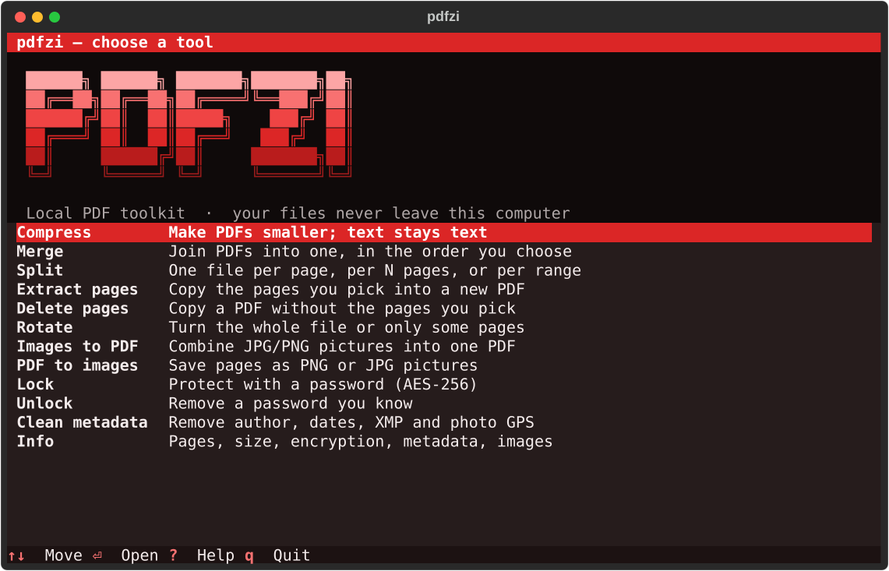
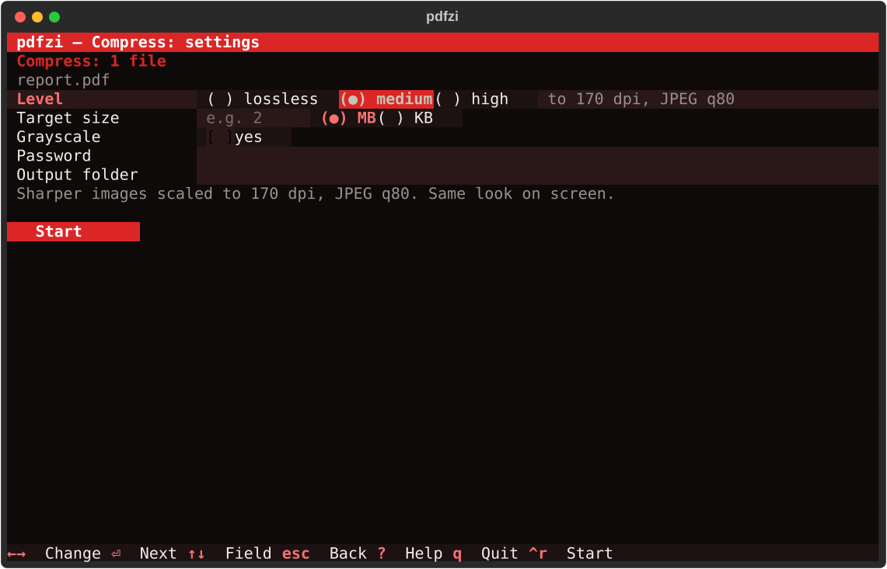

# pdfzi

A local-only PDF toolkit with a red terminal UI and a scriptable CLI.
Compress, merge, split, rotate, lock and more, **without your files ever leaving your computer**.



- **No network, ever.** pdfzi has no code that connects to the internet: no uploads, no telemetry, no update checks.
- **Never overwrites your originals.** Results are new files (`name-2.pdf`, `name-3.pdf` …). Overwriting needs an explicit `--force`.
- **Checks its own work.** Every result is reopened and verified before pdfzi says "done".
- **Works with file names in any language**, including Thai.

## Install

You need Python 3.11 or newer. Pick one:

```bash
# 1. pipx (recommended: keeps pdfzi in its own environment)
pipx install pdfzi

# 2. uv
uv tool install pdfzi

# 3. From source
git clone https://github.com/prompiriyag/pdfzi
cd pdfzi
uv sync
uv run pdfzi
```

Then type `pdfzi`. No `pip install` into your system Python needed.

**Update:** `pipx upgrade pdfzi` or `uv tool upgrade pdfzi`.
**Uninstall:** `pipx uninstall pdfzi` or `uv tool uninstall pdfzi`.

## Use it

Run `pdfzi` with no arguments for the terminal UI. Everything works from the keyboard: the keys for the current screen are always listed at the bottom, and `?` shows help. The mouse works too: a click ticks a file, and buttons under the lists go on, move or remove files.



For scripts and one-liners, use the commands:

```bash
pdfzi compress report.pdf                       # lossless tidy-up (default)
pdfzi compress scan.pdf --level low             # a little smaller, hard to tell apart
pdfzi compress scan.pdf --level medium          # smaller, looks the same on screen
pdfzi compress scan.pdf --target 2MB            # aim for 2 MB or smaller
pdfzi merge a.pdf b.pdf -o all.pdf
pdfzi split book.pdf --every 10                 # or --ranges 1-3,7,10-
pdfzi extract book.pdf --pages 1-3,7
pdfzi delete book.pdf --pages 2,5
pdfzi rotate scan.pdf --angle 90 --pages 1-2
pdfzi img2pdf photo1.jpg photo2.jpg -o photos.pdf
pdfzi pdf2img slides.pdf --format jpg --dpi 150
pdfzi lock secret.pdf                           # asks for the password
pdfzi unlock secret.pdf
pdfzi clean report.pdf                          # remove author, dates, GPS …
pdfzi info *.pdf
```

Every command accepts several files and patterns like `*.pdf`. Add `--json` for machine-readable output and `--help` for all options.

## Good to know

- **Compress.** `lossless` only tidies the file structure; `low`, `medium` and `high` re-encode images that are drawn sharper than 220 / 180 / 140 dpi (JPEG quality 85 / 80 / 70). Text stays text. An image is only replaced if that makes it at least 20 % smaller, and a JPEG that is already of that quality or lower is left alone. A result is kept only if it is at least 1 % smaller, so pdfzi never hands you a bigger file.
- **`--target`.** A plain number means MB (`--target 2`); write `500KB` or `300B` for other units. pdfzi looks for the gentlest settings that fit (at most 9 tries) and, when even those leave room, keeps some images as they were to land close to the target. It never goes below 70 dpi and JPEG quality 45, where text in scans stops being readable: if the target cannot be reached, you get the smallest result and a clear message.
- **Clean.** Removes document info (author, title, dates …), XMP, private app data, thumbnails, the author names and dates of comments, and EXIF/GPS inside photos, and gives the file a new identifier. It does not touch the text of comments, form field names or values, or attached files. A photo stored in a way pdfzi cannot safely unpack is left alone and reported, so you know to check it. Clean is not redaction: it does not remove or hide anything you can see on the pages.
- **Removing pages.** `extract`, `delete` and `split` build a new file from the pages you keep; nothing of the left-out pages stays hidden inside it. Form fields stop being fillable (they still look the same), and bookmarks to removed pages are dropped.
- **Signed or PDF/A files.** Most tools change the file, which breaks a digital signature and PDF/A conformance. pdfzi warns you when it sees either; the original is untouched.
- **Passwords.** A password typed inside a command stays in your shell history. `lock` and `unlock` ask for it (hidden) when you leave `--password` out; in scripts use the `PDFZI_PASSWORD` and `PDFZI_OWNER_PASSWORD` environment variables. `lock` uses AES-256. A forgotten password cannot be recovered. `unlock` needs the password you set (for a file that opens freely but has restrictions, the owner password).

## Limitations

- No OCR: scanned pages stay images.
- Signed PDFs lose their signature when changed, and PDF/A conformance is not re-validated.
- Developed on Windows; the full test suite runs on Windows, macOS and Linux for every change.

## Dependency licenses

pdfzi itself is [MIT](LICENSE). It uses these libraries, installed separately by pip, none of them modified:

| Library | License | Used for |
|---|---|---|
| [pikepdf](https://github.com/pikepdf/pikepdf) | MPL-2.0 | reading and writing PDFs |
| [img2pdf](https://gitlab.mfo.de/mfo/img2pdf) | **LGPL-3.0** | images to PDF (only in one file, `core/imgtopdf.py`) |
| [pypdfium2](https://github.com/pypdfium2-team/pypdfium2) | BSD-3-Clause / Apache-2.0 | rendering pages to images |
| [Pillow](https://github.com/python-pillow/Pillow) | MIT-CMU | image handling |
| [Textual](https://github.com/Textualize/textual) | MIT | terminal UI |
| [Typer](https://github.com/fastapi/typer) | MIT | command line |

img2pdf is LGPL: you may swap it for another version of the library. pdfzi does not use or bundle any GPL or AGPL code (no PyMuPDF, no Ghostscript).

## Contributing

```bash
uv sync
uv run pytest -n auto   # in parallel; plain `uv run pytest` works too
uv run ruff check . && uv run ruff format --check .
```

See [CHANGELOG.md](CHANGELOG.md) for what changed in each version. To report a security problem, see [SECURITY.md](SECURITY.md).
